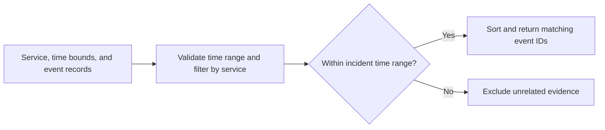

# Incident Investigator Agent

Select time-bounded evidence for the impacted service.

## Quick start

Run `python3 agent.py example.json` with Python 3.10 or newer. Compare the result with `expected.json`. The JSON keys in the example define the supported input shape.

This offline prototype reads synthetic input and returns a recommendation or diagnostic. It uses no credentials, external APIs, or infrastructure mutations. Results require operator review.

## Local verification

Run `make verify` with Make and Python 3 installed. The sample runs through the CLI and its JSON is compared with `expected.json`.

## Business problem

Incident evidence is easier to review when responders can isolate the affected service and time window from a larger event export.

## Project walkthrough



[Architecture and data flow](docs/ARCHITECTURE.md) · [Business problem, demo, and verification](docs/CASE_STUDY.md)

## Run the project

### Local setup

Run `make verify` with Python 3 and Make installed.

### CLI usage

```sh
python3 agent.py example.json
```

### Replay usage

Run `make replay` to replay the checked-in inputs. The runner compares stdout with the baseline, reports differences, and exits nonzero on regression.

[Replay cases](examples/replay-manifest.json) · [Generated report](reports/replay.md) · [Rule implementation](docs/RULES.md)

### Run tests

[Verification report](reports/verification.md) · [Business problem, sample behavior, and limitations](docs/CASE_STUDY.md)


### Limitations

The verification report covers the bundled local examples. See the [case study](docs/CASE_STUDY.md) for project-specific assumptions and operating limits.

## Development and security

See the [developer setup, tool roles, and security checks](docs/DEVELOPMENT.md).

[Local check results](reports/devsecops.md)
