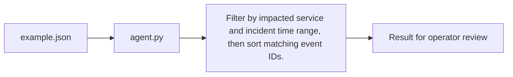

# Incident Investigator Agent architecture

Select time-bounded evidence for the impacted service.

## Operational boundaries

The documented run evaluates the bundled sample locally. Results depend on the quality and scope of the input. The demo makes no live infrastructure changes.
